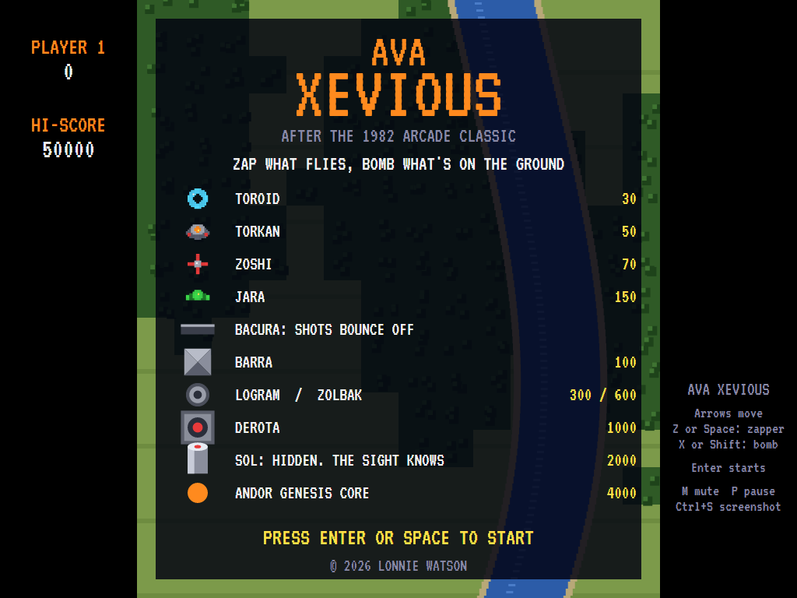
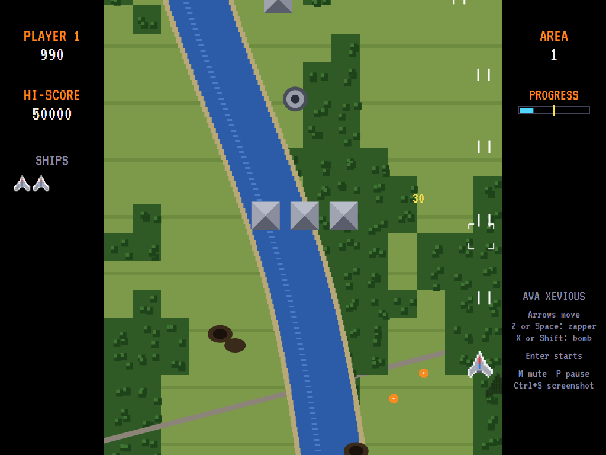
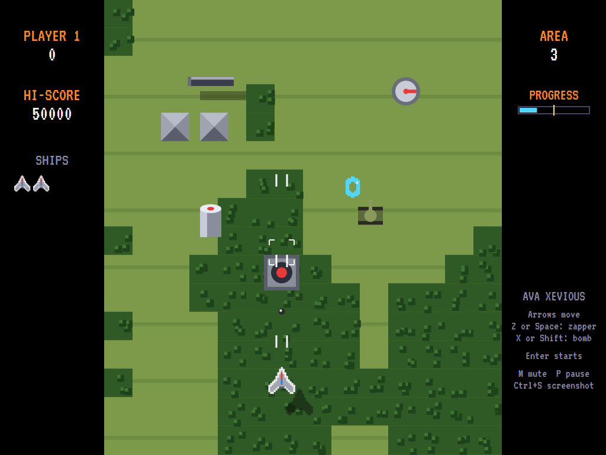
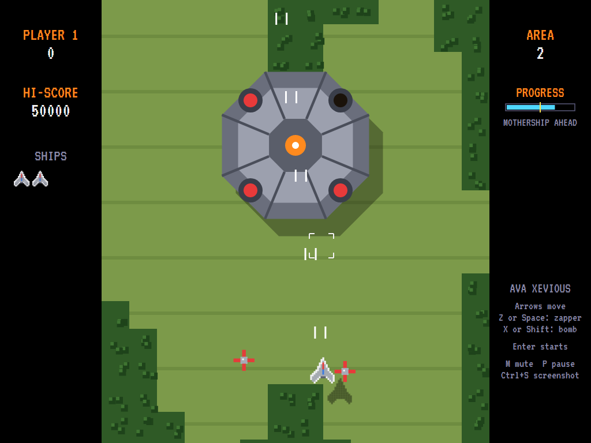
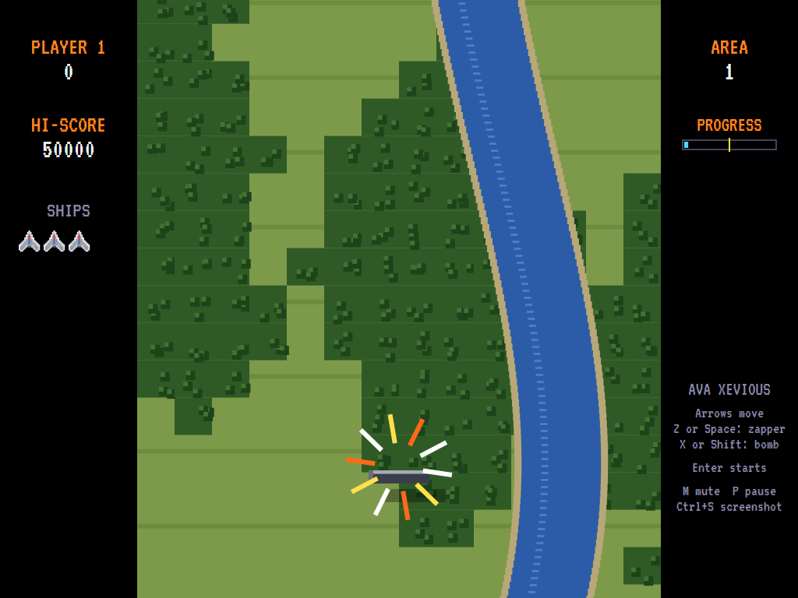
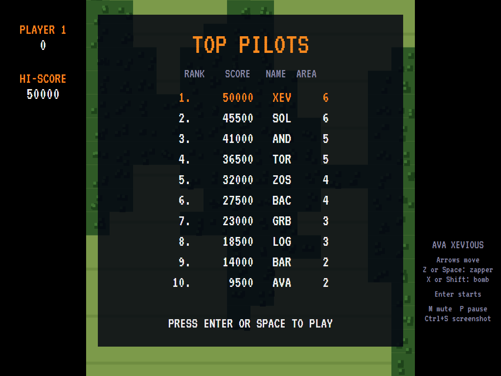

# AVAXevious

[](https://github.com/Harlock123/AVAXevious/actions/workflows/build.yml)

A vertical-scrolling shooter in the style of Namco's 1982 arcade game **Xevious**, built with .NET 10
and Avalonia UI. Fly your fighter up over forests, rivers and roads, zapping the flyers in the air and
bombing what's on the ground through the sight ahead of the ship. Find the hidden towers and take on
the great mothership that hovers over every other area.

## Features

- **Two weapons**: the **zapper** fires straight ahead at anything in the air, and the **blaster**
  drops a bomb on the spot under the **bomb sight**, a fixed distance ahead of the ship. The sight
  flashes red when something is under it.
- **Flyers**:
  - **Toroids** dive in and turn tail.
  - **Torkans** drop in, stop to fire and climb away.
  - **Zoshi** home in in twos and threes.
  - **Jara** swoop back and forth.
  - **Bacura**, great spinning plates, can't be destroyed: your shots bounce off them and you have to
    fly round them.
  
  Enemy shots (*sparios*) can't be shot down, only dodged.
- **On the ground**:
  - **Barra** pyramids, often in threes.
  - **Zolbak** radar domes.
  - **Logram** turrets that fire at you.
  - **Grobda** tanks that run when the sight comes over them.
  - **Derota** gun emplacements firing spreads of shots.
- **Hidden things**:
  - **Sol towers** are buried in every area. The sight gives them away by flashing over bare ground.
    Bomb the spot and a Sol rises for 2,000; bomb it again for another 2,000.
  - Some areas hide a **flag**, which the sight doesn't show. Bomb it out of the ground and fly over it
    for an extra ship.
- **The Andor Genesis**: in every even-numbered area the giant mothership comes over and hangs in the
  sky for a while. Its four guns fire at you. Bomb the guns for 1,000 each, or put a bomb on the core
  in the middle to bring the whole thing down for 4,000. If you don't, it moves on.
- **Sixteen areas** of their own ground: forest, plains, a winding river and roads, all worked out
  from the area number. Each area gets busier, with new kinds of enemy. Lose a ship past the halfway
  mark and you start again from the middle.
- **Sound**: driving original flying music, the zapper and the falling bombs, the bacura's clang, the
  Sol rising, the mothership's warning, and fanfares, all mixed by OpenAL.
- **Attract mode**: leave the title alone for 15 seconds and a computer player plays a demonstration.
  It leads its shots, bombs whatever the sight flashes over (it finds the hidden Sol towers too), goes
  after the mothership's core, and steers round rows of bacura in good time. It usually gets six or
  seven areas in.
- **Three ships**, bonus ships at 20,000, 60,000 and every 60,000 after, and a **top-ten high-score
  table** with arcade-style initials entry. The table records the area you reached.
- **Any window size**: the screen scales to fit, letterboxed. **Ctrl+S** saves a screenshot.
- **One self-contained executable** per platform: Windows, macOS and Linux on Intel/AMD and ARM.

## Screenshots

| Title screen | An area under way | Bombing |
|:------------:|:-----------------:|:-------:|
|  |  |  |
| What's what, and what it's worth. | Area 1: craters where the pyramids were, a road and the river. | The sight on a Derota, a risen Sol tower, a tank, a Toroid and a Bacura. |

| The Andor Genesis | Shot down | The high-score table |
|:-----------------:|:---------:|:--------------------:|
|  |  |  |
| The mothership over area 2, one gun already out. | A Bacura can't be shot. | The best pilots. |

The screenshots are made by the tests, which play the game in a real (headless) window; see
[Tests](#tests).

## Download and run

Ready-to-run builds for Windows, macOS and Linux, on both Intel/AMD and ARM, are on the
[Releases page](https://github.com/Harlock123/AVAXevious/releases/tag/latest). **Latest build** is
rebuilt on every push to `main`. Each download is one self-contained executable: no .NET install is
needed.

| Platform | Archive |
|---|---|
| Windows | `AVAXevious-win-x64.zip`, `AVAXevious-win-x86.zip`, `AVAXevious-win-arm64.zip` |
| macOS | `AVAXevious-osx-arm64.tar.gz` (Apple silicon), `AVAXevious-osx-x64.tar.gz` (Intel) |
| Linux | `AVAXevious-linux-x64.tar.gz`, `AVAXevious-linux-arm64.tar.gz`, `AVAXevious-linux-arm.tar.gz` |

```bash
tar -xzf AVAXevious-linux-x64.tar.gz     # or linux-arm64, linux-arm, osx-arm64, osx-x64
./AVAXevious
```

On Windows, unzip and run `AVAXevious.exe`. On macOS, if Gatekeeper refuses to open it, run
`xattr -d com.apple.quarantine AVAXevious` once. Run with `--no-audio` for silence.

**Sound** comes through OpenAL Soft, built in for every platform. In a virtual machine the game
detects it and uses a larger audio buffer, so the sound doesn't break up.

**Gamepads** use SDL2, which is bundled for Windows, macOS and Intel/AMD Linux. ARM Linux builds need it
installed; without it the keyboard still works:

```bash
sudo apt install libsdl2-dev            # Debian / Ubuntu / Raspberry Pi OS
sudo pacman -S --needed sdl2-compat     # Arch / Omarchy
```

## Controls

| Input | Action |
|-------|--------|
| **Arrow keys** / **WASD** / number pad | Fly |
| **Z** / **Space** / **Ctrl** (hold) | Zapper |
| **X** / **Shift** / **Alt** | Drop a bomb (one at a time) |
| **Enter** / **Space** | Start a game |
| **P** / **Esc** | Pause (Esc again to quit) |
| **M** | Mute |
| **Ctrl+S** / **Cmd+S** | Save a screenshot to the Pictures folder |

**Gamepad**: left stick or D-pad to fly, **A** or the right trigger for the zapper, **B**, **X** or the
left trigger to bomb; **Start** or **A** starts, **Start** pauses, **Back** (while paused) quits.

**Entering initials**: type letters, or dial with **Up**/**Down** and accept with **Space**; **Left** /
**Backspace** go back; **Enter** finishes.

## Scoring

| In the air | Points | On the ground | Points |
|---|---:|---|---:|
| Toroid | 30 | Barra | 100 |
| Torkan | 50 | Grobda | 200 |
| Zoshi | 70 | Logram | 300 |
| Jara | 150 | Zolbak | 600 |
| Bacura | can't be destroyed | Derota | 1,000 |
| | | Sol tower: found, then destroyed | 2,000 + 2,000 |
| | | Mothership gun | 1,000 |
| | | Mothership core | 4,000 |

## Tests

```bash
dotnet test AVAXevious.slnx
```

The engine has no UI and runs in fixed 60 Hz steps, so it plays the same at any frame rate, and a seed
always plays the same game. The tests check:

- the scrolling and the areas, and that every area has its targets, flyers and a hidden Sol, with the
  mothership in every other one;
- the ship's bounds, the zapper against flyers and the Bacura, and shots and bombs only hitting their
  own kind of target;
- the bomb landing where the sight was, the sight flashing, the Sol rising and falling, the flag, and
  the tank running;
- the flyers' ways, being shot down (by a spario and by a Bacura) and starting from the middle;
- the mothership hovering, losing a gun and its core, and coming and going by itself;
- bonus ships, the title tune, the demonstration's sound, pausing, and every sound and sprite.

A computer player (the attract-mode one) plays whole games in them and must score at least 5,000
with no more than two ships lost in the first ninety seconds.

The screenshot tests draw the real screen in a headless window. To refresh the README's pictures:

```bash
XEVIOUS_SHOTS=$PWD/Images dotnet test tests/AVAXevious.Tests --filter ScreenshotTests
```

## Building

```bash
dotnet build AVAXevious.slnx
dotnet run --project src/AVAXevious
```

Needs the .NET 10 SDK. The sounds are made by `tools/make_sounds.py` (standard-library Python):
`python3 tools/make_sounds.py` rewrites `src/AVAXevious/Sounds`.

## Project structure

```
AVAXevious/
├── AVAXevious.slnx
├── src/AVAXevious/
│   ├── Engine/
│   │   ├── GameEngine.cs        # States, scoring, bonus ships and the music
│   │   ├── GameEngine.Play.cs   # Scrolling, the ship, zapper and bombs, the flyers, the ground
│   │   │                        # targets, the mothership, and what hits what
│   │   ├── AreaPlan.cs          # What each area holds, and when the flyers come
│   │   ├── Entities.cs          # The ship, shots, bombs, flyers, ground targets and the mothership
│   │   ├── AttractPilot.cs      # The computer player for the demonstration (and the tests)
│   │   ├── HighScoreTable.cs, InitialsEntry.cs
│   │   ├── InputHandler.cs, ControllerManager.cs  # Keys and an SDL2 gamepad
│   │   └── SoundManager.cs      # Effects, the flying music and the tunes through OpenAL
│   ├── Audio/                   # The OpenAL engine (from the author's AVABand)
│   ├── Models/                  # The field, the ground's look, and the pixel art
│   ├── Views/                   # The screen: the ground, everything on and above it, panels, title
│   │                            # and tables
│   └── Sounds/                  # The synthesised effects and tunes
├── tests/AVAXevious.Tests/      # Gameplay and screenshot tests
├── tools/make_sounds.py
└── Images/                      # Screenshots
```

## About and licence

AVAXevious © 2026 Lonnie Watson, under the [MIT License](LICENSE).

*Xevious* © 1982 Namco (Bandai Namco Entertainment); the names belong to their current owner.
AVAXevious is an independent, unofficial game in its style. Its graphics, ground, sounds, music and
code are its own; nothing is taken from the arcade machine's program, graphics or sound. It is not
affiliated with or endorsed by any rights holder.

Bundled components keep their own licences: the VT323 font (SIL Open Font License 1.1, by Peter Hull;
`src/AVAXevious/Assets/Fonts/VT323-OFL.txt`), OpenAL Soft (LGPL-2.0-or-later; loaded as a separate
library; `src/AVAXevious/Audio/native/COPYING-openal-soft.txt`), and the MIT-licensed Avalonia,
Silk.NET, NVorbis, NLayer and SDL2-CS (with SDL2 under the zlib licence).
